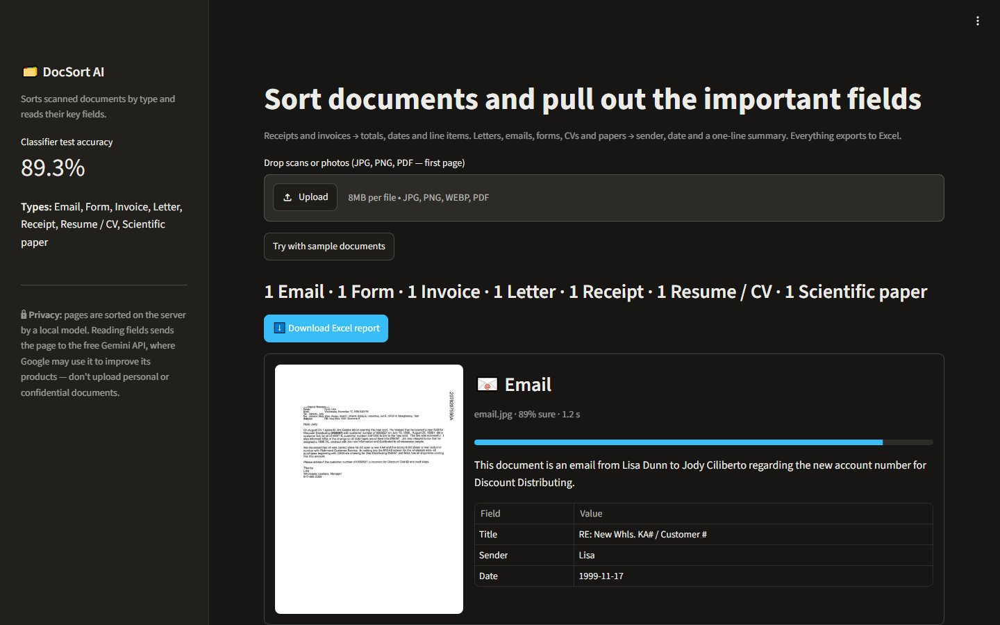
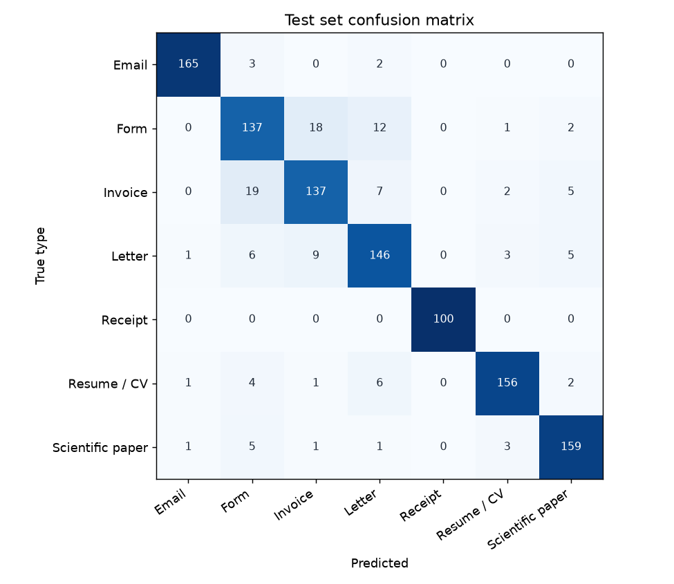

# DocSort AI

Drop in a pile of scanned documents and DocSort **sorts them by type** and **pulls out the important fields** — totals, dates and line items from receipts and invoices; sender, date and a one-line summary from everything else — then exports it all to **Excel**.



| Type | What it extracts |
|---|---|
| 🛒 Receipt | shop, date, currency, line items (name, quantity, price), subtotal, tax, total |
| 🧾 Invoice | invoice number, date, seller, buyer, currency, total, due date |
| ✉️ Letter · 📧 Email · 📝 Form · 👤 Resume · 🔬 Scientific paper | title, sender, date, one-sentence summary |

## How it works

```
 upload (JPG / PNG / PDF)
   │  validate: real image or PDF, size limit, decompression-bomb guard, re-encode (strips metadata)
   ▼
 classifier ── MobileNetV3, fine-tuned by me on 4,500 pages ── runs locally on CPU, ~60 ms, free
   │  type + confidence (below 55 % → "check manually")
   ▼
 Gemini vision ── one schema per type (Pydantic) ── "use only what is printed, otherwise null"
   ▼
 JSON result  ──►  Streamlit page  ──►  Excel report (Documents + Receipt items sheets)
```

**Why train a classifier instead of just asking the LLM?** Sorting is the step that runs on *every* page. A small trained model does it offline, for free, in milliseconds and the same way every time; the LLM is only called for the part that needs reading. The evaluation below compares both on the same pages.

## Training the classifier

- **Data:** 7 types — 6 from [RVL-CDIP](https://adamharley.com/rvl-cdip/) (scanned office documents) and receipts from [CORD v2](https://huggingface.co/datasets/naver-clova-ix/cord-v2) (receipt photos, CC BY 4.0). 650 training pages per type, plus separate validation and test sets.
- **Shortcut prevention:** RVL-CDIP pages are grayscale scans, receipts are colour photos. Every page is converted to grayscale and resized the same way, so the model has to learn layout rather than "photo vs. scan".
- **Transfer learning in two phases:** ImageNet-pretrained MobileNetV3-Large; first only the new 7-class head is trained on frozen features, then the whole network is fine-tuned with a one-cycle learning rate. Augmentation is limited to what real scans do (slight tilt, shift, zoom, lighting — no flips). Label smoothing 0.1.
- Trained on a laptop CPU in about an hour. The model file is 8 MB (fp16).

```bash
python -m docsort.data_prep     # download the data slice (~5 GB) → data/images/
python -m docsort.train         # → models/docsort-classifier.pt + eval/classifier.md
```

## Results

### Classifier — 1,120 test pages never seen in training

**89.3 % accuracy · macro F1 0.90** · 61 ms per page on a laptop CPU · details in [`eval/classifier.md`](eval/classifier.md)

| Type | F1 | | Type | F1 |
|---|---|---|---|---|
| Receipt | 1.00 | | Resume / CV | 0.93 |
| Email | 0.98 | | Letter | 0.85 |
| Scientific paper | 0.93 | | Invoice | 0.81 |
| | | | Form | 0.80 |



Most mistakes are between **forms and invoices** — both are boxed, tabular pages. Receipts are perfect partly because receipt photos simply look different from office scans (narrow paper, different source), even after the grayscale step. Training only the new head on frozen ImageNet features gave 77.9 % on validation; fine-tuning the whole network raised it to 91.0 %.

### Receipt extraction — 100 labelled receipt photos (CORD v2 test set)

| Check | Result |
|---|---|
| Sorted as "receipt" by the local classifier | 100 / 100 |
| **Total amount exactly right** | **92 / 95 (97 %)** |
| Number of line items exactly right | 83 / 100 (within ±1: 93 / 100) |
| Median time per receipt (sort + extract) | 2.2 s |

Two misses were totals written `40.000` (Indonesian thousands separator) read as 40 — the prompt now explains that format, but I have not re-tuned against this test set. Details: [`eval/gemini.md`](eval/gemini.md).

### Trained classifier vs. asking Gemini (same 70 test pages)

| | Trained classifier | Gemini zero-shot |
|---|---|---|
| Accuracy | **62/70 (89 %)** | 59/70 (84 %) |
| Time per page | **37 ms**, offline | 1,380 ms, API call |
| Resumes | 8/10 | 5/10 |

The small specialised model is more accurate *and* ~37× faster than the general LLM for this task — the LLM is kept for what it is good at: reading the fields.

## Safety and privacy

- **Uploads are untrusted:** only real JPEG/PNG/WEBP/TIFF/BMP images or PDFs are accepted (checked by content, not file name), max 8 MB, max 60 megapixels; pages are re-encoded before use, file names are reduced to a safe display name and nothing is written to disk.
- **Prompt injection from documents:** the text in a page is data, not instructions — the model is told to ignore requests inside the document, and every answer must match a fixed schema.
- **Spreadsheet formula injection:** text that starts like a formula (`=`, `+`, `-`, `@`) is stored as plain text in the Excel report, so a receipt can't run `=HYPERLINK(...)` on whoever opens the report (OWASP "CSV injection").
- **No guessing:** fields that aren't printed come back empty.
- **Rate limit** (30 documents/minute per client) and generic error messages; details only in the JSON logs.
- **Free tier:** field extraction uses the free Gemini API, where Google may use inputs to improve its products. Don't upload personal or confidential documents to the demo. Sorting alone runs fully locally — without a key the app still sorts.

## Run it

**With Docker**

```bash
cp .env.example .env               # optional: add a free key from https://aistudio.google.com/apikey
docker compose up --build          # web page: http://localhost:8501 · API docs: http://localhost:8000/docs
```

**Without Docker**

```bash
python -m venv .venv && .venv\Scripts\activate
pip install torch==2.15.0 torchvision==0.29.2 --index-url https://download.pytorch.org/whl/cpu
pip install -r requirements.txt
uvicorn docsort.api:app                       # terminal 1
streamlit run ui/streamlit_app.py             # terminal 2 (set PYTHONPATH=. if needed)
pytest                                        # offline tests, no key or data needed
```

## API

| Endpoint | |
|---|---|
| `POST /classify` | one file → type, confidence, top-3 (local model only) |
| `POST /process` | one file → type + extracted fields |
| `POST /report` | up to 20 files → Excel file |
| `GET /health` | status, classes, classifier test accuracy, whether extraction is on |

## Project layout

```
docsort/
  data_prep.py   download + prepare the training images
  model.py       MobileNetV3 / EfficientNet with a 7-class head, transforms
  train.py       two-phase training, test metrics, confusion matrix
  service.py     upload validation → classify → extract
  extract.py     Pydantic schemas per document type + prompts
  gemini.py      Gemini client: retries, timeout, fallback model
  report.py      Excel export with formula-injection protection
  api.py         FastAPI: /classify /process /report /health
ui/streamlit_app.py
eval/            classifier results, Gemini evaluation script + results
samples/         one test page per type (used by "Try with sample documents")
```

## Data and credits

RVL-CDIP: A. W. Harley, A. Ufkes, K. G. Derpanis, *Evaluation of Deep Convolutional Nets for Document Image Classification and Retrieval*, ICDAR 2015 — a subset of the IIT-CDIP / Legacy Tobacco Documents Library. CORD: Park et al., *CORD: A Consolidated Receipt Dataset for Post-OCR Parsing*, 2019 (CC BY 4.0). The pages in `samples/` come from the test splits of these datasets.

## Built with

Python · PyTorch · torchvision · scikit-learn · Google Gemini API (`google-genai`) · Pydantic · FastAPI · Streamlit · openpyxl · Docker · pytest
