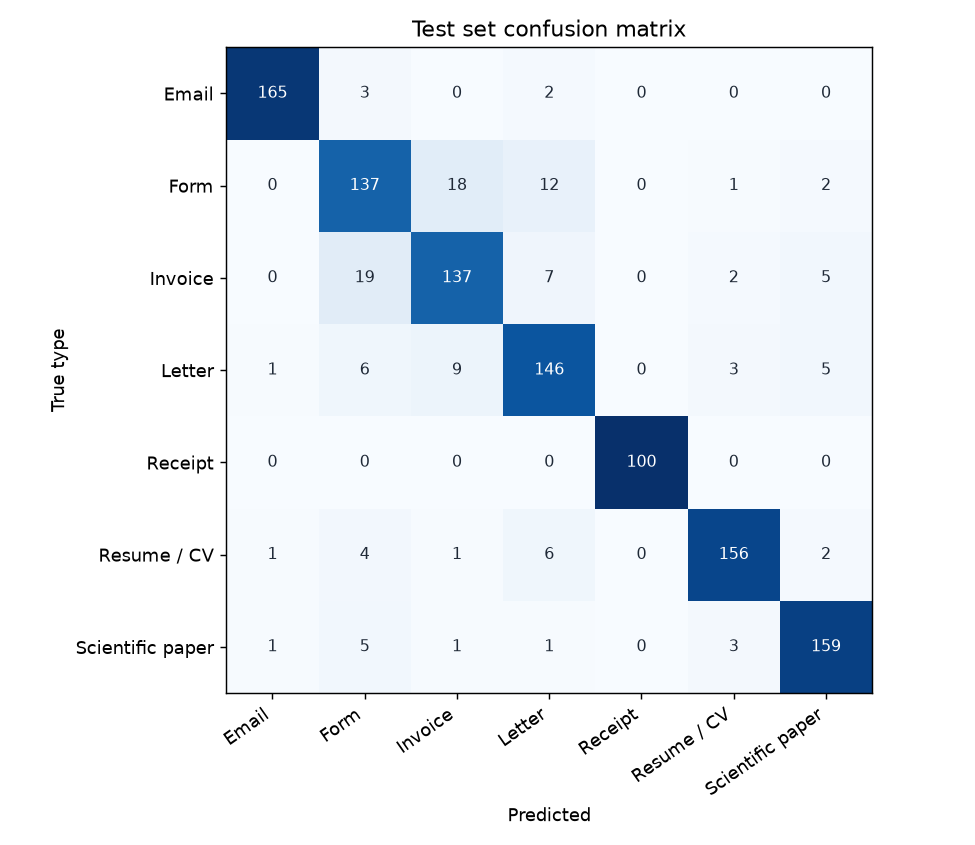

# Classifier results

2026-11-08 · `mobilenet_v3_large` (ImageNet-pretrained) · 320×320 px · 4500 training images · 1120 test images (never seen in training)

**Test accuracy 89.3% · macro F1 0.899**

Training only the new head on frozen ImageNet features reached 77.9% on validation; fine-tuning the whole network raised it to 91.0%.

| Type | Precision | Recall | F1 |
|---|---|---|---|
| Email | 0.98 | 0.97 | 0.98 |
| Form | 0.79 | 0.81 | 0.80 |
| Invoice | 0.82 | 0.81 | 0.81 |
| Letter | 0.84 | 0.86 | 0.85 |
| Receipt | 1.00 | 1.00 | 1.00 |
| Resume / CV | 0.94 | 0.92 | 0.93 |
| Scientific paper | 0.92 | 0.94 | 0.93 |

| Epoch | Phase | Train loss | Val accuracy | Minutes |
|---|---|---|---|---|
| 1 | head | 1.0902 | 68.7% | 5.9 |
| 2 | head | 0.9688 | 77.9% | 4.5 |
| 3 | fine-tune | 0.8686 | 81.2% | 11.2 |
| 4 | fine-tune | 0.7569 | 85.7% | 11.3 |
| 5 | fine-tune | 0.6694 | 88.7% | 11.3 |
| 6 | fine-tune | 0.6077 | 90.5% | 11.4 |
| 7 | fine-tune | 0.5687 | 91.0% | 11.5 |
| 8 | fine-tune | 0.5504 | 91.0% | 11.3 |

